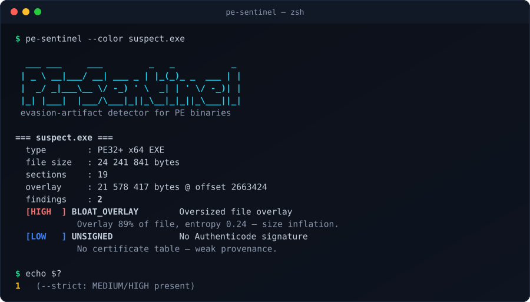

# PE-Sentinel

A small, fast **evasion-artifact detector** for Windows PE binaries (`.exe` / `.dll`), written in portable C++17. It parses the PE format by hand — no Windows APIs — so it builds and runs on Linux, WSL and Windows alike.

Where tooling like [Mangle](https://github.com/optiv/Mangle) *forges* the traces that let a binary slip past an EDR, PE-Sentinel sits on the other side of the fence: it **reads those same traces and flags them**. It is strictly read-only and never writes to the file it inspects.

<p align="center">
  <picture>
    <source media="(prefers-color-scheme: light)" srcset="assets/demo-light.svg">
    
  </picture>
</p>

## What it detects

| Check | ID | What it means |
|-------|----|----|
| Size inflation | `BLOAT_OVERLAY` | A large, low-entropy overlay appended past the last section — padding to exceed an AV's max scan size. |
| Padded section | `BLOAT_SECTION` | A section whose raw bytes dwarf its virtual size, with low entropy — filler that never loads. |
| Stripped Go build ID | `GO_BUILDID_STRIPPED` | Go runtime markers present but the build ID removed — a known signature-evasion step. |
| Missing signature | `UNSIGNED` | No Authenticode certificate table. |
| Timestamp forgery | `TS_ZERO` / `TS_FUTURE` | Zeroed or future `TimeDateStamp` — erased or tampered build provenance. |
| Packing | `HIGH_ENTROPY` | High-entropy executable section suggesting packing/encryption. |

Findings are ranked worst-first and tagged `INFO` / `LOW` / `MEDIUM` / `HIGH`.

## Build

```sh
cmake -S . -B build -DCMAKE_BUILD_TYPE=Release
cmake --build build -j
```

## Usage

```sh
pe-sentinel [options] <file.exe|file.dll> [more files...]

  -q, --quiet     only print findings, skip the image summary
  -s, --strict    exit non-zero if any MEDIUM or HIGH finding is present
  -h, --help      show this help
```

`--strict` makes it usable as a CI / pipeline gate.

## Example

```
$ pe-sentinel -q -s suspect.exe
=== suspect.exe ===
  findings    : 2
  [HIGH  ] BLOAT_OVERLAY        Oversized file overlay
            Overlay of 21578417 bytes (89% of file) at offset 2663424, entropy 0.24.
            Low-entropy padding this large is a hallmark of size inflation.
  [LOW   ] UNSIGNED             No Authenticode signature
            No certificate table. Unsigned on its own is common, but combined
            with other flags it weakens provenance.
exit=1
```

## Scope & intent

PE-Sentinel is a **defensive / analysis** tool for malware triage, threat intel and build-pipeline hygiene. It reports the presence of artifacts; it does not validate certificate chains and it does not modify binaries. It exists to *recognise* tampering, not to perform it.

## License

MIT
