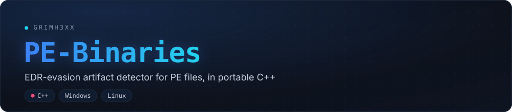
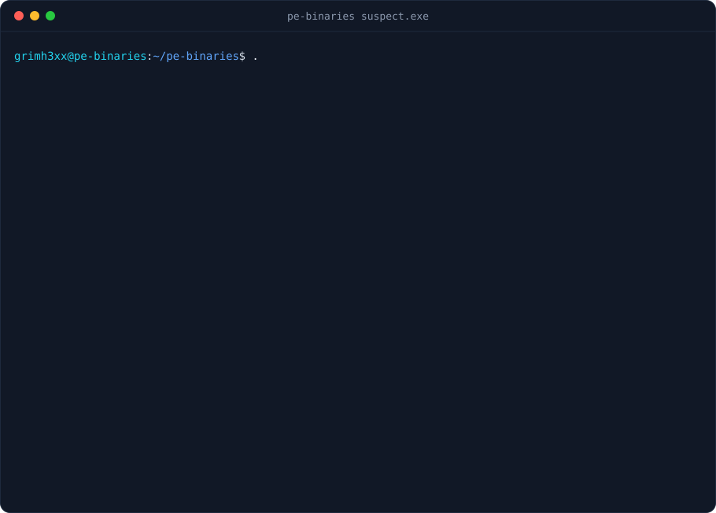

[](https://github.com/grimh3xx/pe-binaries/actions)
[](LICENSE)


**An EDR-evasion artifact detector for Windows PE binaries, in portable C++17.** It parses
the PE format by hand — no Windows APIs — so it builds and runs on Linux, WSL and Windows
alike. Where tooling like [Mangle](https://github.com/optiv/Mangle) *forges* the traces
that let a binary slip past an EDR, PE-Binaries sits on the other side of the fence: it
**reads those same traces and flags them**. Strictly read-only — it never writes to the
file it inspects.

<p align="center"></p>

## What it detects

| | |
|---|---|
| **Size inflation** (`BLOAT_OVERLAY`) | A large, low-entropy overlay appended past the last section — padding to exceed an AV's maximum scan size. Severity scales with how much of the file is filler. |
| **Padded section** (`BLOAT_SECTION`) | A section whose raw bytes dwarf its virtual size, with low entropy — bytes that never load into memory. |
| **Stripped Go build ID** (`GO_BUILDID_STRIPPED`) | Go runtime markers present but the build ID removed — a known signature-evasion step. |
| **Missing signature** (`UNSIGNED`) | No Authenticode certificate table. |
| **Timestamp forgery** (`TS_ZERO` / `TS_FUTURE`) | Zeroed or future `TimeDateStamp` — erased or tampered build provenance. |
| **Packing** (`HIGH_ENTROPY`) | A high-entropy executable section, suggesting packing or encryption. |

Findings are ranked worst-first and tagged `INFO` / `LOW` / `MEDIUM` / `HIGH`. Every check
reads the file; none of them modify it.

## Build

```bash
cmake -S . -B build -DCMAKE_BUILD_TYPE=Release
cmake --build build -j
```

No dependencies beyond a C++17 compiler and CMake. Builds with GCC, Clang and MSVC.

## Usage

```text
pe-binaries [options] <file.exe|file.dll> [more files...]

  -q, --quiet     only print findings, skip the image summary
  -s, --strict    exit non-zero if any MEDIUM or HIGH finding is present
      --color     force ANSI color (default: auto when stdout is a TTY)
      --no-color  disable ANSI color
  -h, --help      show this help
```

`--strict` makes it usable as a CI / pipeline gate: a MEDIUM or HIGH finding fails the run.

```bash
pe-binaries suspect.exe                 # full report
pe-binaries -q -s build/*.exe           # gate a build directory
pe-binaries --no-color sample.dll | tee report.txt
```

## How it reads a PE

| Stage | What it looks at |
|---|---|
| Headers | DOS + NT signatures, machine, `TimeDateStamp`, PE32/PE32+ |
| Sections | raw vs virtual size, per-section Shannon entropy, executable flag |
| Overlay | bytes past the last section's raw data and the certificate table |
| Security dir | presence and size of the Authenticode certificate table |
| Go markers | `.gopclntab` / `.go.buildinfo` sections and build-ID strings |

## Scope & intent

PE-Binaries is a **defensive / analysis** tool for malware triage, threat intel and
build-pipeline hygiene. It reports the *presence* of artifacts; it does not validate
certificate chains, and it does not modify binaries. It exists to **recognise** tampering,
not to perform it.

## Development

```bash
python3 tools/gen_demo.py          # regenerate docs/demo.svg (animated terminal)
```

The banner and demo SVGs are generated art (JBM font embedded); they match the rest of the
[grimh3xx](https://github.com/grimh3xx) profile.

## License

MIT
